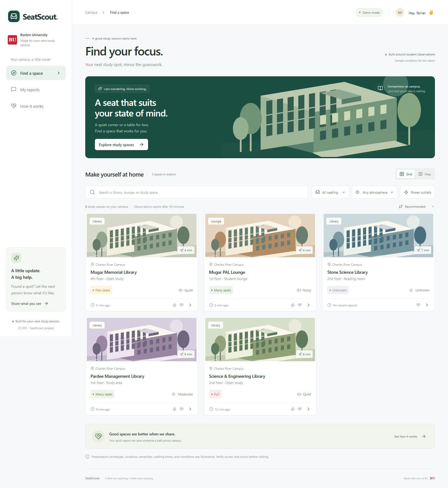

# BU Seat-Scout

Seat Scout helps Boston University students find study spaces and report seating and atmosphere. The [native Android app](android/README.md) is the current Project Update 1 deliverable.

## Android demo

Open the `android/` folder in Android Studio and run **app** on an emulator or phone. Open a study area, tap **Update conditions**, select seating and atmosphere, and save. Force-stop and reopen the app to show that the report persists locally. Reports expire after 30 minutes.

## Web prototype demo

Download [Seat-Scout.html](Seat-Scout.html) and open it in your browser to try the interactive demo offline. Regenerate the standalone file with `npm run build:offline`.



### Run the web prototype from source

Requires Node.js 20.19+ or 22.12+.

```powershell
npm install
npm run dev
```

Open http://127.0.0.1:5173. Keep the terminal running during your presentation. For a production preview, run `npm run build` followed by `npm run preview` (port 4173).

No accounts, API keys, external fonts or image downloads are needed. The campus illustrations and map are included in the app.

## A 90-second presentation

1. **The problem:** “Between classes, students need to know whether a study space has seating and the right surroundings.” Show the five sample areas.
2. **Find a fit:** Filter atmosphere to Quiet and turn on Power outlets. Reset filters and switch to Map.
3. **Show uncertainty:** Open Stone Science Library. It shows Unknown because the sample reports are older than 30 minutes.
4. **Contribute:** Select Report conditions, choose Many seats and Quiet, and submit. Open Stone again to see the new conditions.
5. **Explain trust:** Open My reports. Your observation is timestamped and saved on this browser. In How it works, explain 30-minute expiry and Mixed when recent reports disagree.

**Say clearly:** “This is the frontend prototype with illustrative locations, amenities, walking times, and observations. These are not live campus conditions.” There are no reservations or exact seat counts. External Directions opens Google Maps with the example building address.

To reset your observations, clear this site's browser storage. Sample observations restart when the app reloads. New reports persist in this browser, but are not sent to a server. They expire from current conditions after 30 minutes, while remaining in My reports.

## Design and cloud preparation

- [Editable Figma screens](https://www.figma.com/design/GU8NIjb5MjqueipwZh8Dh4): desktop discovery, mobile discovery, and report dialog. These are design reference frames; the local app is the working interactive demonstration.
- **Firebase:** `firebase.json` configures static Hosting for the Vite `dist` output and SPA routes. No cloud project was created or deployed. Once you choose a Firebase project, run `npm run build`, authenticate with `npx -y firebase-tools@latest login`, then deploy using `npx -y firebase-tools@latest deploy --only hosting --project YOUR_PROJECT_ID`.
- **Supabase:** an optional client and catalog connectivity helper live in `src/backend.js`, with public configuration placeholders in `.env.example`. They are not wired into the sample UI. No Supabase project, schema, authentication, or shared reports were created. Connecting real data requires a catalog schema, data mapping, appropriate RLS policies and BU authentication. Never put a service-role key in a frontend environment variable.

## Verification

```powershell
npm test
npm run build
node scripts/smoke.mjs
```

The smoke test launches a temporary preview on port 5174 and uses an installed Google Chrome at its standard Windows path. Change that path if Chrome is installed elsewhere. It checks desktop/mobile layout, filtering, no-results state, unknown conditions, report validation and persistence, map selection, directions, keyboard focus containment and browser errors. It saves screenshots in `docs/screenshots`.

Built with React, Vite, Lucide icons, and an optional Supabase SDK. Local observations are versioned and validated before use. This demo does not implement BU identity checks, shared multi-device observations, contribution rate limits, or verified building access/hours.
